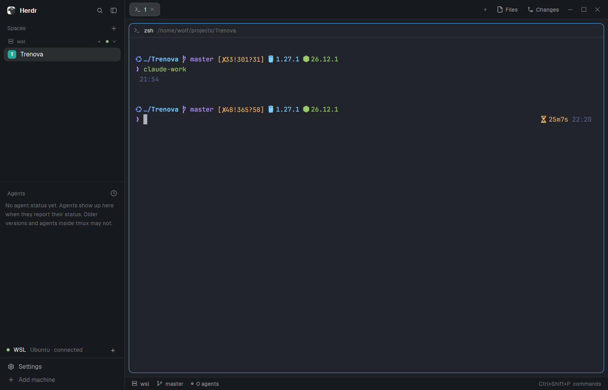

# herdr-wsl

[Herdr](https://herdr.dev) on Windows, working in **WSL 2**.

Your distro becomes a Herdr machine and the place new spaces go: your Linux shell,
git and agents run natively, and Herdr follows your Linux folders (tabs, Files,
Changes, git status). The sidebar drops "This computer" while you have no Windows
spaces, and a WSL row shows the connection, reconnects it, and keeps WSL from idling
out.



## Install

```powershell
git clone https://github.com/emoss08/herdr-wsl
cd herdr-wsl
powershell -ExecutionPolicy Bypass -File .\setup.ps1
```

It asks before each step, skips what's already done, and ends with Herdr on the
`main-wsl` layout. Options: `-Distro <name>`, `-Port 2222`, `-Machine wsl`, `-Yes`,
`-Uninstall`. Or ask your agent to *"add the Herdr layout at
github.com/emoss08/herdr-wsl"*: it follows [`RECIPE.md`](RECIPE.md).

**Never want PowerShell spaces?** Add `"redirect_local": true` to
`~/.config/herdr-app/mods/wsl/config.json`: a plain shell space made on Windows (the
palette's New space, for example) is swapped for a WSL space. Spaces that start an
agent or a program are left alone.

## What it changes

Herdr's core on Windows reaches other machines only over ssh
([herdr-app#172](https://github.com/herdrdev/herdr-app/issues/172) asks for a
native WSL path), so setup:

- **In the distro** (as root, via `wsl -u root`): installs an OpenSSH server (apt,
  dnf, zypper or pacman), listening on **127.0.0.1 only**, **key login only**
  (`/etc/ssh/sshd_config.d/herdr-wsl.conf`).
- **On Windows:** creates `~/.ssh/herdr_wsl_ed25519` (no passphrase, so Herdr
  connects unattended), authorizes it in the distro **from 127.0.0.1 only**, and adds
  a marked `Host wsl` block to `~/.ssh/config`.
- Runs `hc machine add wsl --install` (herdr-core inside the distro).
- Installs into `~/.config/herdr-app`: `mods/wsl` (the WSL row), `mods/wsl-spaces`
  (Herdr's spaces list, Apache-2.0, changed to hide an empty "This computer" and
  send `+` to WSL), `layouts/main-wsl.json`, and `ctrl-shift-n` → new WSL space in
  that layout (`keys.json` is backed up first).

The mods run only `wsl.exe` and `hc`: one hidden `wsl.exe -- sleep infinity` keeps
the distro up, and a no-op `hc exec` reconnects the machine when it drops.

`setup.ps1 -Uninstall` undoes it, one machine at a time (the OpenSSH package stays
installed).

## Requirements

Herdr app with herdr-core, WSL 2, a distro with systemd (the default on current
Ubuntu, Debian, Fedora, openSUSE and Arch images), the Windows OpenSSH client.

Tested on herdr-app 0.1.11 / hc 0.1.16 and WSL 3.0.3 with Ubuntu 24.04 and 26.04,
Fedora 44, openSUSE Tumbleweed and Arch Linux, NAT and mirrored networking. After
`wsl --shutdown` Herdr is back on its own in about 20–30 seconds.

## License

MIT. `mods/wsl-spaces` is a modified copy of Herdr's `spaces` mod, Apache-2.0
(its LICENSE is alongside).
