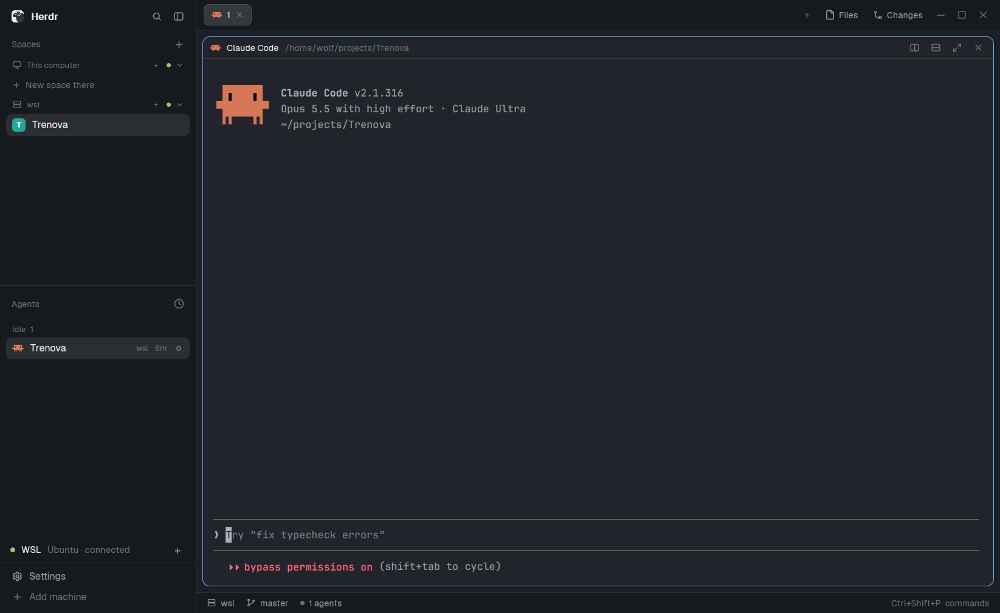

# WSL

Herdr spaces that run in Linux on Windows. Your WSL 2 distro becomes a Herdr
machine, so a space made there runs zsh/bash, git and agents in Linux, and
Herdr follows its Linux folders (new tabs, the Files and Changes panels, git
status). A slim row in the sidebar shows whether WSL is connected and opens a
new WSL space with one click.

## What you see

- One row, 34px tall, at the bottom of the sidebar (above Settings / Add
  machine), on the sidebar's `chrome` background, 12.5px text, 14px side
  padding, 8px gaps:
  - a 7px round status dot,
  - "WSL" in `foreground`,
  - the distro and the connection in `dim`, truncated: `Ubuntu · connected`,
  - a `+` (15px, `muted`, `hover` background and `foreground` on hover) at the
    right end.
- When the sidebar is folded to a rail (narrower than 160px): only the dot,
  centered, in a 6px-padded hover target.
- Spaces on WSL appear in Herdr's own spaces list under the machine's name
  (`wsl`), like any other machine.

## How it behaves

- The dot and word follow Herdr's view of the machine (`machines()[].layout`):
  `ready` → `ansi2` "connected", `loading` → `ansi3` "connecting",
  `unavailable` → `blocked` "offline". If the machine doesn't exist yet the
  word is "not set up: run setup.ps1" in `dim` and there is no `+`.
- Clicking `+` (or the dot on the rail) runs `space.new {machine: "wsl"}`: a
  new space whose first terminal is the distro's login shell in your Linux home.
- Key: `wsl.new-space` does the same. The shipped `keys.json` binds it to
  `ctrl-shift-n` in the `layout:main-wsl` section (rename the section to your
  layout's name), so it replaces Herdr's `space.new` only in that layout.
- It keeps the distro running: WSL stops a distro with no Windows-side
  session after a short idle, and that would take the machine offline. The
  mod keeps one hidden local hc terminal, `wsl-keepalive`, running
  `wsl.exe -d <distro> -- sleep infinity`, and starts it again within 30s if it
  ends (for example after `wsl --shutdown`). It has no Herdr labels, so it
  shows in no space.
- Agent statuses (working, blocked, done, idle) are Herdr's own: agents in WSL
  spaces show in the agents list like local ones.

## Built from

- **One-time setup, `setup.ps1`** (Windows PowerShell 5.1 or PowerShell 7).
  Herdr's core on Windows reaches other machines only over ssh: `hc machine
  add --via <command>` refuses every command there ("one line, run by sh
  here"), `wsl.exe` included. So the script:
  1. inside the distro, as root through `wsl -u root` (no password): installs
     `openssh-server` with apt, writes `/etc/ssh/sshd_config.d/herdr-wsl.conf`
     (`Port 2222`, `ListenAddress 127.0.0.1`, no password or keyboard-interactive
     login), disables `ssh.socket` and enables/restarts the plain `ssh` service;
  2. on Windows: makes `~/.ssh/herdr_wsl_ed25519` (ed25519, no passphrase,
     comment `herdr-wsl`), appends it to the distro user's
     `~/.ssh/authorized_keys`, and appends a `Host wsl` entry (127.0.0.1, port,
     user, that key, `IdentitiesOnly yes`, `StrictHostKeyChecking accept-new`)
     between `# >>> herdr-wsl` / `# <<< herdr-wsl` markers in `~/.ssh/config`;
  3. runs `hc machine add wsl --name wsl --install` (copies hc into the distro);
  4. writes `mods/wsl/config.json`: `{"machine": "wsl", "distro": "<name>"}`.
  Options: `-Distro` (default: WSL's default distro), `-Port` (2222),
  `-Machine` (`wsl`), `-Yes` (don't ask before each step), `-Uninstall`.
  Steps already done are skipped (if `ssh wsl` already connects, step 2 is).
- **Layout:** a block in the sidebar column between `sidebar-lists` and
  `sidebar-footer`:
  `{ "id": "wsl", "type": "block", "content": { "mod": "wsl" }, "size": { "px": 34 } }`.
  Herdr's shipped layouts are read-only, so clone one first
  (`herdr-app do layout.clone '{"name":"main","as":"main-wsl"}'`) and add the
  block to the clone.
- **`mods/wsl`** (`place: "none"`), one `main.js`:
  - reads `config.json` with `readTextFile(appHome() + "/mods/wsl/config.json")`;
    without it, machine `wsl` and the distro marked `*` in `wsl.exe -l -v`
    (UTF-16 output: strip NULs and the BOM before parsing);
  - `machines()` for the state, `run("space.new", {machine})`,
    `nextCommand()` for `wsl.new-space`, `terminals()` to find the keepalive
    by name, `hc([...])` to start it (`run --bg --no-parent --no-notify --rm
    --name wsl-keepalive --label wsl.role=keepalive`), `cx.timer.every(30000)`.
- Programs it runs: `wsl.exe` (once to find the default distro, and the
  keepalive), `hc`. No network access; reads only its own `config.json`.

## Watch out

- If `main.js` is saved before `mod.json` exists, Herdr docks the mod with
  the default placement (a 320px column on the right). Write `mod.json` first,
  or delete that extra block from the layout.
- The mod only runs (and keeps WSL alive) in layouts that contain its block;
  `<mod>.<command>` keys reach shown copies only.
- Ubuntu 22.10+ starts sshd from `ssh.socket` by default; the script turns
  that off and runs `ssh.service`. Verified: sshd comes back on its own after
  `wsl --terminate`.
- Only apt distros (Ubuntu, Debian) are set up by the script, and they need
  systemd (`[boot] systemd=true` in `/etc/wsl.conf`, the default on current
  Ubuntu images). Elsewhere, run an sshd on 127.0.0.1 yourself; the rest of
  the script still works.
- All WSL 2 distros share one network: two distros set up this way need
  different `-Port`s. A port already taken on Windows breaks localhost
  forwarding; the script reports it and suggests `-Port`.
- PowerShell 5.1 gotchas the script works around: `` "`uFEFF" `` isn't an
  escape there (use `''` in regex), `""` isn't passed to programs before
  PowerShell 7.3 (use `'""'` for `ssh-keygen -N`), and `wsl.exe -- '<line>'`
  passes the whole line as one word (scripts go through a temp file and
  `wslpath`).
- The key has no passphrase so Herdr can connect unattended; sshd accepts it
  only from 127.0.0.1.
- Tested with herdr-app 0.1.11, hc 0.1.16, WSL 3.0.3, Ubuntu 24.04 and 26.04,
  NAT networking. Mirrored networking mode is untested.

## Done when

- `setup.ps1` finishes with `ssh wsl` connecting without a prompt and
  `hc machine ls` showing `wsl` as `connected`; running it again skips every step.
- `herdr-app check ~/.config/herdr-app/mods/wsl` passes.
- The sidebar row shows `Ubuntu · connected` with a green dot.
- `+` opens a space under `wsl` whose terminal is the distro's shell in
  `/home/<user>`, and its header shows the Linux folder.
- `hc ls` shows `wsl-keepalive` running `wsl.exe`; `hc kill wsl-keepalive`
  brings a new one within 30s.
- `setup.ps1 -Uninstall` removes the machine, the Host entry and its
  known_hosts line, the key (and its authorized_keys line), and stops sshd.
